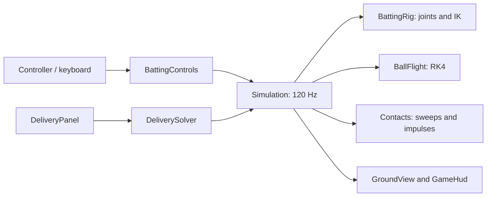

# Architecture

`GameController` owns one `Simulation`. Godot calls it at 120 physics ticks per second. `BattingControls` supplies a small `BattingInput` value; `Simulation.Tick` advances joints and contacts in eight fixed substeps. `GameHud` and `GroundView` read the results. The core uses a double-precision `Vec2`, with +x toward the batter and +y upward. The screen projection maps increasing x to the left: the bowler-end wicket is at the right and the striker-end wicket at the left. Physics coordinates and the length measurement still originate at the bowler-end wicket.

## State ownership

`Setup → Windup → Live → Setup`. The initial simulation is idle in `Setup` with the panel hidden. Controller A or the on-screen A button opens the panel. A successful `Begin` clears delivery feedback and maxima, creates a fresh rig, and hides the panel. Windup lasts 1.25 s. Live starts at release and has no time limit. Only the explicit A-button action returns it to setup; the same press cannot also launch a delivery. Opening setup freezes simulation and retains measurements until the next `Begin`. Window focus loss suspends ticks. UI settings persist because the same panel instance is reused.

`DeliveryStatistics` observes the release state, every live substep and both sides of each collision impulse. It retains maximum speed magnitude, absolute horizontal distance from the normal batting stance, and height above ground. It lives in the engine-independent core so sampling is unaffected by rendering rate. `SpeedUnits` converts km/h entry to m/s once at the UI boundary, and converts m/s to km/h when displaying live/maximum speed. The setup range of 18–180 km/h therefore preserves the existing 5–50 m/s physics range.

The solver and live flight share `BallFlight.Integrate`, including the same physical coefficients and substep. The solver brackets the first reachable angular root, bisects it, and uses `GroundTime` to locate the ball-centre height equal to its radius. It never teleports the live ball onto the requested length.

Within a live substep, the simulation predicts free flight, finds the earliest contact, advances to that contact, applies an impulse, then integrates the remaining time. Up to six contacts are resolved in one substep to bound pathological corner-contact work. The core reports contacts through `Events`; UI feedback is derived from delivery state and does not alter collision decisions.

## Why a custom collision core

The blueprint suggests starting with `RigidBody2D`. This implementation uses a small purpose-built SI solver for the one ball, pitch plane and moving bat. That lets the release-angle solver and actual gameplay use exactly the same integration, and allows all physics tests to run without Godot. There is no second Godot physics body applying additional gravity or resolving duplicate impacts.

Capsule sweeps use conservative advancement with a bound on relative endpoint travel. The ball path and rotating blade endpoints are approximated as linear only within a 1/960 s interval. Ground crossing uses RK4 and a bisection search. This is a tested approximation, not an exact curved-motion CCD solver. The batter is permanently invulnerable: his visible body, pads and helmet have no ball collision shapes. Bat and wicket contacts remain active.

## Extend without mixing responsibilities

| Change | Place |
| --- | --- |
| Air/seam model or wind | `BallFlight` and explicit settings |
| Pitch presets / calibration | `SimulationSettings`, JSON config and ground contact laws |
| Additional delivery inputs | `DeliverySettings`, solver and setup panel |
| Controller remapping | `BattingControls`; keep `BattingInput` engine-independent |
| Bat/body recoil | Rig dynamics and contact response, not the renderer |
| Different character art | `GroundView`, driven by the existing `HumanPose` |
| Sound or replay capture | Consume contact events / record tick inputs |
| Scoring or match flow | A separate rules layer consuming delivery events |
| More cameras | A new presentation transform; keep SI state unchanged |

The `.gdignore` files keep the standalone core, camera helpers and test sources out of Godot's asset importer. C# project references still compile the core normally; camera helpers are compiled into the game and linked into the tests. No external physics/test package is required. NuGet is intentionally configured to use the installed engine's bundled packages, copied by the launcher into `.local/godot-packages`; add a package source explicitly if future dependencies need one.

## Camera and field presentation

`Presentation/FieldCamera` is independent of Godot. It fits the ball and both wicket lines into the drawing rectangle, reserving space below the HUD. Horizontal travel anchors the far wicket at the opposite edge. If the ball is above the pitch, the vertical fit may require a wider scale; the same scale applies to both axes. Framing transitions continuously as the ball crosses the pitch. Scale only decreases during a delivery, avoiding repeated zoom changes as the ball falls, and resets when there is no live ball.

`GroundView` uses this transform for the pitch, characters, bat, ball, trajectory and boundary stakes. The compact four-stat HUD retains its screen-space size during zoom. Maximum distance and boundary positions use the batter's normal stance at physical x = 19.08 m as their stable horizontal reference, defined by `PitchDimensions.BatterReferenceX`. Left boundary x = 56.08 m (37 m from the batter); right boundary x = -55.92 m (75 m from the batter). Posts and signboards stay anchored to those world coordinates; off-screen markers are hidden instead of pinned to a screen edge. This reference does not change delivery lengths, which still start at the bowler's wicket. Height measurements use physical world y above ground and never derive measurements from pixels. The field ruler, end labels and separate height annotation are no longer drawn.

Controller elbow inversion is confined to the `JoyAxis.RightX` action bindings. Keyboard elbow controls, `JoyAxis.LeftX` swing, and `JoyAxis.RightY` wrist controls retain their directions.

## Animation model

The left stick controls the lead shoulder's target sweep and a small crouch. The right stick changes elbow flexion and wrist offset. A damped joint controller limits angular velocity and acceleration. Forward kinematics preserves the lead arm's two bone lengths. The rear arm solves to the same grip using two-link IK. Legs solve from the moving hip to fixed ankles. A wrist correction prevents the blade entering the ground.

The bat is driven by this pose. Its contact velocity includes grip translation plus angular velocity crossed with the contact lever. The impulse uses finite bat effective mass, but does not drive a fully dynamic human or return recoil into the arms. This one-way coupling is an explicit first-version approximation. Human mass distribution, shoulder socket limits in three dimensions, changing grip compliance and muscle torque need a later biomechanics model.

For play verification, the core test sweeps swing timings around a delivery and checks that some shots hit the bat cleanly. This does not substitute for testing the feel and mapping of a real controller.
