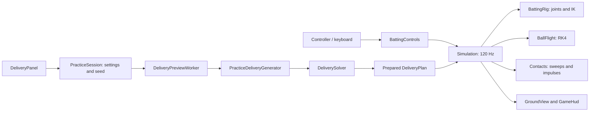

# Architecture

`GameController` owns one `Simulation`. Godot calls it at 120 physics ticks per second. `BattingControls` supplies a small `BattingInput` value; `Simulation.Tick` samples the rig once at 120 Hz, then sweeps ball contacts through eight substeps using reconstructed intermediate poses. `GameHud` and `GroundView` read the results. The core uses a double-precision `Vec2`, with +x toward the batter and +y upward. The screen projection maps increasing x to the left: the bowler-end wicket is at the right and the striker-end wicket at the left. Physics coordinates and the length measurement still originate at the bowler-end wicket.

## State ownership

The front end starts at `Main Menu → Practice → Batting`. `MainMenu` owns only navigation and disabled choices; `GameController` constructs the existing simulation, field and HUD on the first Batting selection. Menu input is consumed before gameplay input, so selecting Batting cannot also open or begin a delivery. Returning through Escape during play, or B/Escape inside setup, hides the gameplay UI and suspends ticks; selecting Batting again resumes the same session. Exit quits the application. The separate `--batting-preview` developer mode bypasses these menus.

`Setup → Windup → Live → Setup`. The initial simulation is idle in `Setup` with the panel hidden. Free batting rehearsal advances the rig in this state without advancing the ball, delivery clock or statistics. Visible delivery settings suspend those rehearsal ticks so navigation input cannot drive the bat. Controller View/Select or keyboard Enter opens Batting Practice Settings; inside it, A/Enter activates the focused control. Only Bowl starts the prepared delivery. A successful `BeginPrepared` clears feedback and maxima, creates a fresh rig, and hides the panel. Windup lasts 1.25 s. Live starts at release and has no time limit. Only an explicit View/Enter action returns it to setup; the same press cannot also launch a delivery. Opening setup freezes simulation and retains measurements until the next start. Window focus loss suspends ticks. User pause (Start/Menu or Space) is tracked separately and survives focus restoration.

`PracticeSession` retains immutable `PracticeBowlingSettings`, independent `PracticeGuides`, a pending plan and its seed for the game session. Opening settings after consuming a ball advances the seed once; focus, guide toggles and menu navigation do not. Delivery-setting changes replace pending preparation using the same seed. `Core/Practice/PracticeBowling.cs` owns the five profiles and engine-independent generator. It samples integer centimetres and tenths of km/h with inclusive endpoints, validates candidates with the solver, and retries only randomized fields up to 64 times before an extremal fallback. Manual values are preserved. Failed preparation keeps Bowl disabled with an actionable error.

`DeliveryStatistics` observes the release state, every live substep and both sides of each collision impulse. It retains maximum speed magnitude, absolute horizontal distance from the normal batting stance, and height above ground. It lives in the engine-independent core so sampling is unaffected by rendering rate. `SpeedUnits` converts km/h entry to m/s once at the UI boundary, and converts m/s to km/h when displaying live/maximum speed. The setup range of 18–180 km/h therefore preserves the existing 5–50 m/s physics range.

The solver and live flight share `BallFlight.Integrate`, including the same physical coefficients and substep. The solver brackets the first reachable angular root, bisects it, and uses `GroundTime` to locate the ball-centre height equal to its radius. It never teleports the live ball onto the requested length.

Within a live substep, the simulation predicts free flight, finds the earliest contact, advances to that contact, applies an impulse, then integrates the remaining time. Up to six contacts are resolved in one substep to bound pathological corner-contact work. The core reports contacts through `Events`; UI feedback is derived from delivery state and does not alter collision decisions.

## Why a custom collision core

The blueprint suggests starting with `RigidBody2D`. This implementation uses a small purpose-built SI solver for the one ball, pitch plane and moving bat. That lets the release-angle solver and actual gameplay use exactly the same integration, and allows all physics tests to run without Godot. There is no second Godot physics body applying additional gravity or resolving duplicate impacts.

Capsule sweeps use conservative advancement with a bound on relative endpoint travel. The ball path and rotating blade endpoints are approximated as linear only within a 1/960 s interval. Ground crossing uses RK4 and a bisection search. This is a tested approximation, not an exact curved-motion CCD solver. The batter is permanently invulnerable: his visible body, pads and helmet have no ball collision shapes. Bat and wicket contacts remain active.

## Extend without mixing responsibilities

| Change | Place |
| --- | --- |
| Air/seam model or wind | `BallFlight` and explicit settings |
| Pitch presets / calibration | `SimulationSettings`, JSON config and ground contact laws |
| Bowler types and random practice options | `BowlerProfiles`, `PracticeBowlingSettings`, generator and setup panel |
| Additional physical delivery inputs | `DeliverySettings` and solver |
| Controller remapping | `BattingControls`; keep `BattingInput` engine-independent |
| Rotation gesture, shot selection and trigger weight transfer | `Config/batsman.json` and `BattingSettings`; see `BATTING.md` |
| Bat/body recoil | Rig dynamics and contact response, not the renderer |
| Different batter art | `BatterModel` and `Assets/Characters/batsman.glb`, driven by `HumanPose`; shared by `GroundView` and `BattingPreview` |
| Sound or replay capture | Consume contact events / record tick inputs |
| Scoring or match flow | A separate rules layer consuming delivery events |
| More cameras | A new presentation transform; keep SI state unchanged |

The `.gdignore` files keep the standalone core, camera helpers and test sources out of Godot's asset importer. C# project references still compile the core normally; camera helpers are compiled into the game and linked into the tests. No external physics/test package is required. NuGet is intentionally configured to use the installed engine's bundled packages, copied by the launcher into `.local/godot-packages`; add a package source explicitly if future dependencies need one.

## Camera and field presentation

`PitchLengthScale` maps world distances onto the full 25 m slider rail, independently of the selectable 8–25 m range. `PitchLengthSlider` draws both wickets and its draggable handle using that same mapping. `DeliveryPanel` presents the bowler selector, random/manual choices, sliders and independent guides in unnumbered boxes. Random mode shows ranges instead of sampled values. The speed slider spans 18–180 km/h and classifies its category; explicit category selection clamps remembered manual speed. The settings body scrolls while status and Bowl remain fixed. Keyboard/controller focus skips hidden sliders, and B/Escape closes the native dropdown before returning to the menu. The diagram never changes the physics pitch dimensions. Main menu focus uses charcoal/ivory inversion and supports left-stick repetition as well as D-pad, mouse and keyboard navigation.

`GroundView.Guides` separately controls the landing marker in every phase and the predicted path before release. `ShowBallTrail`, toggled by T during gameplay, affects only the live trail. These presentation properties never request another delivery or change its seed.

`Presentation/FieldCamera` is independent of Godot. It fits the ball and both wicket lines into the drawing rectangle, reserving space below the HUD. Horizontal travel anchors the far wicket at the opposite edge. If the ball is above the pitch, the vertical fit may require a wider scale; the same scale applies to both axes. Framing transitions continuously as the ball crosses the pitch. Scale only decreases during a delivery, avoiding repeated zoom changes as the ball falls, and resets when there is no live ball.

`GroundView` uses this transform for the pitch, characters, bat, ball, trajectory and physical boundary crossings. The compact five-stat HUD retains its screen-space size during zoom; FPS uses Godot's measured rendering rate. Maximum distance and boundary positions use the batter's normal stance at physical x = 19.08 m as their stable horizontal reference, defined by `PitchDimensions.BatterReferenceX`. Default inner wedge toes are x = 59.08 m (40 m left of the batter) and x = -55.92 m (75 m right). White triangular cushions replace the distance signs. The physical barricade lies 5 m clear beyond the cushion's outer toe. Height and distance measurements never derive from pixels.

`Core/Field/FieldSettings` owns validated dimensions and material settings loaded from `Config/field.json`. `FieldGeometry` supplies the two wedge profiles, both barricade profiles and the normal-offset oval function. `Simulation.AdvanceBall` sweeps these surfaces alongside ground, bat and wicket contacts. `Contacts.SurfaceImpulse` applies restitution and spin-aware Coulomb friction, and `SurfaceMotion` handles supported sliding/rolling under gravity. Separate boundary/wall events preserve wicket state and update delivery statistics normally.

`FieldDrawing` uses that same geometry for the complete oval, outer wall and surrounding parking. `FieldLayout.Project` adds scenery depth while agreeing exactly with `FieldCamera` at depth zero. The ball stays in the existing 2D vertical plane; the decorative portions of the oval outside that plane do not imply a third ball-motion axis. The sky is an exported, editable Inkscape asset. See [STADIUM.md](STADIUM.md) and [BOUNDARY_REFERENCES.md](BOUNDARY_REFERENCES.md) for dimensions, assumptions and evidence.

`BattingControls` reads the raw left-stick vector, held X/A/B/Y shot actions and proportional triggers. Right-stick batting is disabled. `SwingGesture` requires a near-8:30 outer anchor, applies radial hysteresis and a small rotation gate, then tracks the absolute 8:30 → 6 → 3 → 12 clock arc. Direct pushes, jitter, centre crossings and discontinuities cannot start a stroke.

## Animation model

`BattingSettings` loads `Input`, `Swing` and `Body` from JSON. `BattingRig` reads A/X/B/Y every fixed tick, before, during and after a stroke; releasing modifiers restores A without re-arming. A is the zero/default mode. Progress equals the absolute stick angle with no temporal smoothing or speed limit. X/B clamp at 2/1:30, A/Y at 12. Centre release recovers toward 8:30 at a configurable rate. A fresh deliberate arc can interrupt recovery. Entering the start zone after an off-angle push remains possible without a forced centre reset. Leaving the legal arc releases the old gesture, allowing another full rim rotation to re-arm instead of accumulating an extra revolution at the finish.

The right stick is disabled. `BattingStroke` maps arm clock to the selected blade angle. The top grip stays on that clock ray; analytic reach/clearance bounds shorten extension where needed. The bottom grip remains on the same handle and both arms retain fixed segment lengths. R2 minus L2 still drives smoothed pelvis transfer and lift/plant footwork. See [BATTING.md](BATTING.md) for the complete mapping, sources and assumptions.

The bat is driven by this pose. Its contact velocity includes grip translation plus angular velocity crossed with the grip-to-contact lever. The collision response converts to a centre-of-mass lever and inertia before calculating the finite bat effective mass; mixing a grip inertia with centre-of-mass translation is incorrect. Measured property references and the parallel-axis conversion are in [CRICKET_REFERENCES.md](CRICKET_REFERENCES.md). The collision does not drive a fully dynamic human or return recoil into the arms. This one-way coupling is an explicit approximation. Human mass distribution, shoulder socket limits in three dimensions, changing grip compliance and muscle torque need a later biomechanics model.

For play verification, the core test sweeps swing timings around a delivery and checks that some shots hit the bat cleanly. This does not substitute for testing the feel and mapping of a real controller.

## Supporting motion and render snapshots

`BattingMotion` owns weight damping, foot trajectories/contact states, the rear toe pivot and animation phase. `BattingRig` advances controls, weight and footwork once per tick. Collision substeps reconstruct intervening joints from compact frames; they never consume the same input sample eight times. This gives bat velocity the full input-sample interval.

`BattingFrame` stores stroke progress, weight shift, selected shot and both foot transforms. `Simulation.PreviousFrame` and `Batter.Frame` bound the current physics tick. Within a mode, collision sweeps interpolate these compact values and rebuild constrained joints. When the mode changes, `SampleBatMotion` interpolates the old and new bat grip/angle across the full tick instead of applying the new mode in the first substep. On a new stroke, `BattingRig.MotionFromFrame` supplies the preceding stick-sample pose; interrupting recovery therefore cannot create an artificial collision impulse from resetting the pose. Live character rendering uses the current authoritative `Batter.Pose` directly, removing one tick of visual lag.

`BattingRig` produces `AthletePose`: shared 3D shoulders, grips, elbows, hips, knees and foot joints. `BatterModel` applies those joints to 18 cached independent bones from the Blender GLB using validated, exported rest lengths; it does not solve a different set of arms. Cached rest-roll offsets orient arm skin around the actual elbow plane, avoiding fixed-forward roll flips. The wrist skin follows the forearm while glove geometry follows the bat. A small transparent orthographic viewport composites the character into the 2D field. Its bat projects onto the core's physical grip, direction and front-face normal. There are no dynamic human collision bodies or per-frame mesh rebuilds.

`GroundView` uses `RenderFraction` for the ball; the batter uses the newest fixed-tick pose. Automatic Node interpolation is disabled because this is a custom CanvasItem renderer. Focus pause freezes that fraction; setup uses the current frame, and delivery resets initialize both history endpoints. This follows Godot's [manual interpolation guidance](https://docs.godotengine.org/en/stable/tutorials/physics/interpolation/advanced_physics_interpolation.html) while keeping gameplay entirely on fixed physics ticks.

`--batting-preview` branches before constructing the delivery scene. Its engine-independent `BattingPreviewSession` owns a separate rig and fixed 120 Hz accumulator with the same rig step as gameplay. `LastInput` also supports the preview's stick-versus-arm clock display. Playback scales accumulated time; rendering reads the current pose. Pause freezes it, single stepping advances one tick, and looping/reset/reload clear old snapshots. `BattingPreview` supplies native controls and telemetry; `BatterModel` supplies the same skinned character used in the match. Reload parses and validates a replacement before committing any state and never writes a file.

## Rendering and preview work

`FieldDrawing` builds immutable world primitives once and projects them into two retained `FieldMesh` buffers when camera framing changes. The foreground mesh preserves the existing painter order relative to the pitch and characters. GPU buffer regions are updated in place; unchanged views reuse both geometry and custom draw commands. `GroundView` invalidates idle drawing on pose, delivery phase, preview or display-option changes. Owned meshes are disposed on scene exit; the imported sky texture is shared.

`DeliveryPreviewWorker` owns at most one cancellable solver task and one pending request. Main-thread requests replace pending work; main-thread polling publishes only the latest revision. Solver work is engine-independent and never touches UI or Godot resources. Disposal cancels work. `Simulation.BeginPrepared` accepts the exact preview plan after checking its physics configuration; it does not solve again. The existing `Simulation.Begin(DeliverySettings, ...)` API still solves synchronously for core callers, then shares the same reset/windup initialization.

Rendering remains independent of fixed simulation ticks. Focus loss pauses simulation and limits background rendering to 30 FPS; focus return removes the engine cap. VSync remains configurable through Godot's presentation settings. Opt-in diagnostics live under `Scripts/Diagnostics` and have no recurring benchmark overhead during ordinary play. See [PERFORMANCE.md](PERFORMANCE.md) for measurements and reproduction commands.

`ContactEvent` includes relative closing speed and optional bat-contact measurements. `ImpactSoundSelector` applies ordered rules from `Config/audio.json` without a Godot dependency. `ImpactAudio` consumes events after each physics tick and plays preloaded samples through a bounded voice pool. Audio decisions never feed back into simulation; lifecycle controls stop or pause playback with the delivery. See [AUDIO.md](AUDIO.md) for adding sounds and categories.
