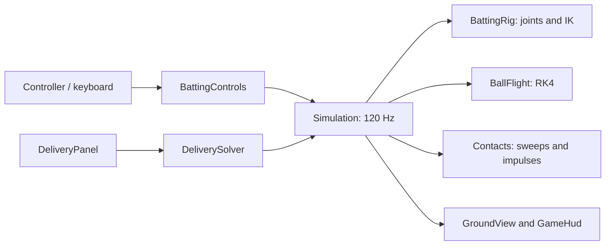

# Architecture

`GameController` owns one `Simulation`. Godot calls it at 120 physics ticks per second. `BattingControls` supplies a small `BattingInput` value; `Simulation.Tick` advances joints and contacts in eight fixed substeps. `GameHud` and `GroundView` read the results. The core uses a double-precision `Vec2`, with +x toward the batter and +y upward. The screen projection maps increasing x to the left: the bowler-end wicket is at the right and the striker-end wicket at the left. Physics coordinates and the length measurement still originate at the bowler-end wicket.

## State ownership

The front end starts at `Main Menu → Practice → Batting`. `MainMenu` owns only navigation and disabled choices; `GameController` constructs the existing simulation, field and HUD on the first Batting selection. Menu input is consumed before gameplay input, so selecting Batting cannot also open or begin a delivery. Returning through B or Escape hides the gameplay UI and suspends ticks; selecting Batting again resumes the same session. Exit quits the application. The separate `--batting-preview` developer mode bypasses these menus.

`Setup → Windup → Live → Setup`. The initial simulation is idle in `Setup` with the panel hidden. Controller A or keyboard Enter opens Batting Practice Settings. A successful `Begin` clears delivery feedback and maxima, creates a fresh rig, and hides the panel. Windup lasts 1.25 s. Live starts at release and has no time limit. Only an explicit A/Enter action returns it to setup; the same press cannot also launch a delivery. Opening setup freezes simulation and retains measurements until the next `Begin`. Window focus loss suspends ticks. UI settings persist because the same panel instance is reused.

`DeliveryStatistics` observes the release state, every live substep and both sides of each collision impulse. It retains maximum speed magnitude, absolute horizontal distance from the normal batting stance, and height above ground. It lives in the engine-independent core so sampling is unaffected by rendering rate. `SpeedUnits` converts km/h entry to m/s once at the UI boundary, and converts m/s to km/h when displaying live/maximum speed. The setup range of 18–180 km/h therefore preserves the existing 5–50 m/s physics range.

The solver and live flight share `BallFlight.Integrate`, including the same physical coefficients and substep. The solver brackets the first reachable angular root, bisects it, and uses `GroundTime` to locate the ball-centre height equal to its radius. It never teleports the live ball onto the requested length.

Within a live substep, the simulation predicts free flight, finds the earliest contact, advances to that contact, applies an impulse, then integrates the remaining time. Up to six contacts are resolved in one substep to bound pathological corner-contact work. The core reports contacts through `Events`; UI feedback is derived from delivery state and does not alter collision decisions.

## Why a custom collision core

The blueprint suggests starting with `RigidBody2D`. This implementation uses a small purpose-built SI solver for the one ball, pitch plane and moving bat. That lets the release-angle solver and actual gameplay use exactly the same integration, and allows all physics tests to run without Godot. There is no second Godot physics body applying additional gravity or resolving duplicate impacts.

Capsule sweeps use conservative advancement with a bound on relative endpoint travel. The ball path and rotating blade endpoints are approximated as linear only within a 1/960 s interval. Ground crossing uses RK4 and a bisection search. This is a tested approximation, not an exact curved-motion CCD solver. The batter is permanently invulnerable: his visible body, pads and helmet have no ball collision shapes. Bat and wicket contacts remain active.

## Extend without mixing responsibilities

| Change | Place |
| --- | --- |
| Air/seam model or wind | `BallFlight` and explicit settings |
| Pitch presets / calibration | `SimulationSettings`, JSON config and ground contact laws |
| Additional delivery inputs | `DeliverySettings`, solver and setup panel |
| Controller remapping | `BattingControls`; keep `BattingInput` engine-independent |
| Swing phases, wrist limits, arm poses and stance | `Config/batsman.json` and `BattingSettings`; see `BATTING.md` |
| Bat/body recoil | Rig dynamics and contact response, not the renderer |
| Different batter art | `BatterDrawing`, driven by `HumanPose`; shared by `GroundView` and `BattingPreview` |
| Sound or replay capture | Consume contact events / record tick inputs |
| Scoring or match flow | A separate rules layer consuming delivery events |
| More cameras | A new presentation transform; keep SI state unchanged |

The `.gdignore` files keep the standalone core, camera helpers and test sources out of Godot's asset importer. C# project references still compile the core normally; camera helpers are compiled into the game and linked into the tests. No external physics/test package is required. NuGet is intentionally configured to use the installed engine's bundled packages, copied by the launcher into `.local/godot-packages`; add a package source explicitly if future dependencies need one.

## Camera and field presentation

`PitchLengthScale` maps world distances onto the full 25 m slider rail, independently of the selectable 8–25 m range. `PitchLengthSlider` draws both wickets and its draggable handle using that same mapping. `DeliveryPanel` groups the slider and numeric field inside one shared focus frame and synchronizes their values, preserving incomplete text such as the first digit of 25 while updating valid edits live. The diagram never changes the physics pitch dimensions. Main menu focus is shown by charcoal/ivory inversion and supports left-stick repetition as well as D-pad, mouse and keyboard navigation.

`Presentation/FieldCamera` is independent of Godot. It fits the ball and both wicket lines into the drawing rectangle, reserving space below the HUD. Horizontal travel anchors the far wicket at the opposite edge. If the ball is above the pitch, the vertical fit may require a wider scale; the same scale applies to both axes. Framing transitions continuously as the ball crosses the pitch. Scale only decreases during a delivery, avoiding repeated zoom changes as the ball falls, and resets when there is no live ball.

`GroundView` uses this transform for the pitch, characters, bat, ball, trajectory and physical boundary crossings. The compact five-stat HUD retains its screen-space size during zoom; FPS uses Godot's measured rendering rate. Maximum distance and boundary positions use the batter's normal stance at physical x = 19.08 m as their stable horizontal reference, defined by `PitchDimensions.BatterReferenceX`. Default inner wedge toes are x = 59.08 m (40 m left of the batter) and x = -55.92 m (75 m right). White triangular cushions replace the distance signs. The physical barricade lies 5 m clear beyond the cushion's outer toe. Height and distance measurements never derive from pixels.

`Core/Field/FieldSettings` owns validated dimensions and material settings loaded from `Config/field.json`. `FieldGeometry` supplies the two wedge profiles, both barricade profiles and the normal-offset oval function. `Simulation.AdvanceBall` sweeps these surfaces alongside ground, bat and wicket contacts. `Contacts.SurfaceImpulse` applies restitution and spin-aware Coulomb friction, and `SurfaceMotion` handles supported sliding/rolling under gravity. Separate boundary/wall events preserve wicket state and update delivery statistics normally.

`FieldDrawing` uses that same geometry for the complete oval, outer wall and surrounding parking. `FieldLayout.Project` adds scenery depth while agreeing exactly with `FieldCamera` at depth zero. The ball stays in the existing 2D vertical plane; the decorative portions of the oval outside that plane do not imply a third ball-motion axis. The sky is an exported, editable Inkscape asset. See [STADIUM.md](STADIUM.md) and [BOUNDARY_REFERENCES.md](BOUNDARY_REFERENCES.md) for dimensions, assumptions and evidence.

Both sticks preserve screen-space X/Y directions. `BattingControls` reads raw radial vectors; `BattingRig` applies the JSON dead zones once. WASD supplies the shoulder vector and arrow keys the wrist vector. There is no independent elbow input.

## Animation model

`BattingSettings` loads `Config/batsman.json` at startup and is retained across delivery resets. Its `Input`, `Swing`, `Wrist`, `Arms` and `Stance` objects use validated circular keyframe curves. See [BATTING.md](BATTING.md) for units and examples. Configuration clock angles follow the screen, with 0 at 12 and 90 at 3.

The left stick controls the shoulder-to-fist ray. The manual arc runs counterclockwise from 8 through 7 and 2 to 12, followed by a committed swept return from 12 to 8. Before the arm reaches 12, reverse motion can travel clockwise back to 8 but cannot cross that hard stop. Reverse speed uses the lower of its absolute cap and a fraction of the current forward ceiling; a separate acceleration limit produces a slower backlift. Actual shoulder motion triggers the snap. Forward stick wrapping is retained while the arm catches up, and reverse wrapping is clamped at the backstop. A held follow-through input cannot repeatedly trigger another cycle. World rotation stays unwrapped for continuous bat contact velocities.

The right stick requests a screen-space blade direction about the fist, clamped to the current shoulder angle's wrist envelope. Partial deflection blends with the neutral angle. It cannot affect shoulder motion, grip position, elbow flexion or stance. A centred right stick preserves a straight bat and straight arms through the default 8-to-1 arc. Both projected shoulders share a root; two-link IK preserves both arm lengths while elbow flexion varies with swing position. Legs solve from the moving hip to animated foot anchors; planted anchors remain fixed. Stance validation guarantees ground clearance without changing wrist or shoulder angles.

The bat is driven by this pose. Its contact velocity includes grip translation plus angular velocity crossed with the grip-to-contact lever. The collision response converts to a centre-of-mass lever and inertia before calculating the finite bat effective mass; mixing a grip inertia with centre-of-mass translation is incorrect. Measured property references and the parallel-axis conversion are in [CRICKET_REFERENCES.md](CRICKET_REFERENCES.md). The collision does not drive a fully dynamic human or return recoil into the arms. This one-way coupling is an explicit approximation. Human mass distribution, shoulder socket limits in three dimensions, changing grip compliance and muscle torque need a later biomechanics model.

For play verification, the core test sweeps swing timings around a delivery and checks that some shots hit the bat cleanly. This does not substitute for testing the feel and mapping of a real controller.

## Supporting motion and render snapshots

`BattingMotion` lives in the engine-independent core and reads actual shoulder motion only. It owns body damping, foot trajectories/contacts, the rear toe pivot, head compensation and animation phase. `BattingRig` builds physical hands and bat from this moving shoulder on every substep. Collision velocity therefore includes the same weight transfer shown on screen. The right stick only changes the wrist scalar.

`BattingFrame` stores roots, unwrapped shoulder angle, elbow flexion, wrist angle, head angle and foot anchors/orientations. `Simulation.PreviousFrame` is captured before a physics tick, while `Batter.Frame` holds the completed tick. The renderer interpolates these parameters and then calls `BattingRig.BuildPose` to reconstruct both arms and legs with IK. Interpolating individual elbows and knees would shrink bones; this approach preserves them and the shared fist pivot.

`GroundView` uses one `RenderFraction` for the ball and batter. Automatic Node interpolation is disabled because this is a custom CanvasItem renderer. Focus pause freezes that fraction; setup uses the current frame, and delivery resets initialize both history endpoints. This follows Godot's [manual interpolation guidance](https://docs.godotengine.org/en/stable/tutorials/physics/interpolation/advanced_physics_interpolation.html) while keeping gameplay entirely on fixed physics ticks.

`--batting-preview` branches before constructing the delivery scene. Its engine-independent `BattingPreviewSession` owns a separate rig and fixed 120 Hz accumulator with the same substeps as gameplay. Playback scales accumulated time; rendering uses the remaining fraction. Pause retains that fraction, single stepping synchronizes history, and looping/reset/reload clear old snapshots. `BattingPreview` supplies native controls and telemetry; `BatterDrawing` supplies the same existing artwork used in the match. Reload parses and validates a replacement before committing any state and never writes a file.
